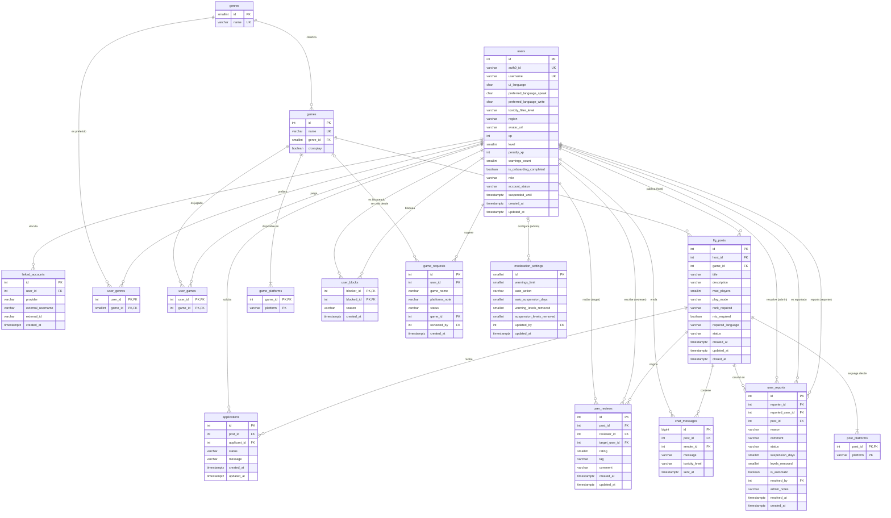

# Fase 2: Diseño de la Base de Datos

**Proyecto:** SquadFinder LFG
**Motor:** PostgreSQL 15+ (alojado en Neon)
**Scripts:** [`backend/database/schema.sql`](../backend/database/schema.sql) (creación), [`seed.sql`](../backend/database/seed.sql) (catálogos) y [`seed_demo.sql`](../backend/database/seed_demo.sql) (datos de prueba)

---

## 1. Modelo Entidad-Relación (MER)

### Relaciones

| Relación | Cardinalidad | Implementación |
|---|---|---|
| Usuario – cuentas vinculadas | 1:N | `linked_accounts.user_id` → `users.id` |
| Usuario – géneros favoritos | M:N | Tabla intermedia `user_genres` |
| Usuario – juegos habituales | M:N | Tabla intermedia `user_games` |
| Género – juegos | 1:N | `games.genre_id` → `genres.id` |
| Usuario (anfitrión) – salas | 1:N | `lfg_posts.host_id` → `users.id` |
| Juego – salas | 1:N | `lfg_posts.game_id` → `games.id` |
| Usuario – salas (como miembro) | M:N | Tabla intermedia `applications`, con atributos propios (`status`, `message`) |
| Sala – reseñas | 1:N | `user_reviews.post_id` → `lfg_posts.id` |
| Usuario – reseñas | 1:N dos veces | `reviewer_id` (quien califica) y `target_user_id` (quien es calificado) |
| Sala – mensajes | 1:N | `chat_messages.post_id` → `lfg_posts.id` |
| Usuario – mensajes | 1:N | `chat_messages.sender_id` → `users.id` |
| Juego – plataformas | 1:N (catálogo) | `game_platforms.game_id` → `games.id` |
| Sala – plataformas | 1:N | `post_platforms.post_id` → `lfg_posts.id`; varias solo si el juego tiene `crossplay` |
| Usuario – reportes | 1:N tres veces | `reporter_id` (quien reporta), `reported_user_id` (reportado), `resolved_by` (administrador) |
| Sala – reportes | 1:N | `user_reports.post_id` → `lfg_posts.id` (partida donde ocurrió) |
| Usuario – usuario (lista negra) | M:N | Tabla intermedia `user_blocks` (`blocker_id`, `blocked_id`) |
| Usuario – juegos sugeridos | 1:N | `game_requests.user_id` → `users.id`; al aprobarse, `game_requests.game_id` → `games.id` |

## 2. Esquema relacional

Notación: **subrayado = PK**, *cursiva = FK*.

- **genres** (<u>id</u>, name)
- **games** (<u>id</u>, name, *genre_id*, crossplay)
- **game_platforms** (<u>*game_id*</u>, <u>platform</u>)
- **users** (<u>id</u>, auth0_id, username, ui_language, preferred_language_speak, preferred_language_write, avatar_url, toxicity_filter_level, region, xp, level, penalty_xp, warnings_count, is_onboarding_completed, role, account_status, suspended_until, created_at, updated_at)
- **moderation_settings** (<u>id</u>, warnings_limit, auto_action, auto_suspension_days, warning_levels_removed, suspension_levels_removed, *updated_by*, updated_at)
- **user_blocks** (<u>*blocker_id*</u>, <u>*blocked_id*</u>, reason, created_at)
- **game_requests** (<u>id</u>, *user_id*, game_name, platforms_note, status, *game_id*, *reviewed_by*, created_at)
- **linked_accounts** (<u>id</u>, *user_id*, provider, external_username, external_id, created_at)
- **user_genres** (<u>*user_id*</u>, <u>*genre_id*</u>)
- **user_games** (<u>*user_id*</u>, <u>*game_id*</u>)
- **lfg_posts** (<u>id</u>, *host_id*, *game_id*, title, description, max_players, play_mode, rank_required, mic_required, required_language, status, created_at, updated_at, closed_at)
- **post_platforms** (<u>*post_id*</u>, <u>platform</u>)
- **applications** (<u>id</u>, *post_id*, *applicant_id*, status, message, created_at, updated_at)
- **user_reviews** (<u>id</u>, *post_id*, *reviewer_id*, *target_user_id*, rating, tag, comment, created_at, updated_at)
- **chat_messages** (<u>id</u>, *post_id*, *sender_id*, message, toxicity_level, sent_at)
- **user_reports** (<u>id</u>, *reporter_id*, *reported_user_id*, *post_id*, reason, comment, status, *resolved_by*, admin_notes, resolved_at, created_at)

**Vistas:**

| Vista | Contenido | Página que la usa |
|---|---|---|
| `v_lfg_posts` | `lfg_posts` + nombre del juego + usuario, **nivel**, foto y **región** del anfitrión + `current_players` (calculado) | `index.html`, `detalle_post.html` |
| `v_post_members` | Miembros de cada sala: el anfitrión (`HOST`) y las solicitudes aceptadas (`MEMBER`), con usuario, región, nivel y foto | `detalle_post.html`, `chat_sala.html` |
| `v_match_history` | Una fila por usuario, partida terminada y **compañero con el que jugó**, e indica si ya lo calificó (`already_reviewed`) o reportó (`already_reported`) | `historial_partidas.html` |
| `v_reports_admin` | Reportes con usuario, nivel y **advertencias** del reportado, total de reportes y **cuántos de sus mensajes en esa partida marcó el filtro PNL** (evidencia) | `admin_reportes.html` |

`v_match_history` también incluye `is_blocked` (si el compañero está en tu lista negra).

**Funciones:**

| Función | Qué hace | Quién la usa |
|---|---|---|
| `level_from_xp(xp)` | Convierte XP en nivel: XP negativa = 0 (Rookie); 0–99 = 1; cada 100 XP más, +1; máximo 10 | Triggers de niveles |
| `review_xp(user_id)` | Suma la XP de las reseñas recibidas (5★ = 30, 4★ = 20, 3★ = 10, 1–2★ = 0), contando como máximo 3 reseñas de cada compañero | Triggers de niveles |
| `resolve_report(...)` | Aplica la decisión del administrador (descartar, advertir, suspender, eliminar), descuenta niveles y aplica la **regla automática** al llegar al límite de advertencias | API de moderación |
| `feed_for_user(user_id)` | Salas abiertas sin las de anfitriones de la **lista negra** del usuario ni las de cuentas sancionadas | `index.html` |

`v_lfg_posts` también incluye `platforms` (lista de plataformas de la sala) y `game_crossplay`.

## 3. Diccionario de datos

Convenciones:

- **PK:** llave primaria.
- **FK:** llave foránea.
- **UK:** valor único.
- **Nulo:** indica si el campo acepta valores vacíos.

Todas las PK numéricas se generan automáticamente (`GENERATED ALWAYS AS IDENTITY`).

### 3.1 `users`: usuarios registrados

| Campo | Tipo | Nulo | Clave | Default | Descripción / restricciones |
|---|---|---|---|---|---|
| id | INTEGER | No | PK | auto | Identificador interno |
| auth0_id | VARCHAR(128) | No | UK | — | Identificador del usuario en Auth0 (`sub` del JWT) |
| username | VARCHAR(30) | No | UK | — | Nombre visible; 3–30 caracteres alfanuméricos o `_` |
| ui_language | CHAR(2) | No | — | `'es'` | Idioma de la interfaz: `es` o `en` |
| preferred_language_speak | VARCHAR(4) | No | — | `'es'` | Idioma en que habla: `es`, `en` o `both` (ambos) |
| preferred_language_write | VARCHAR(4) | No | — | `'es'` | Idioma en que escribe: `es`, `en` o `both` (ambos) |
| avatar_url | VARCHAR(500) | Sí | — | — | Foto de perfil: URL de la imagen subida o `preset:<emoji>` para un avatar prediseñado |
| toxicity_filter_level | VARCHAR(6) | No | — | `'MEDIUM'` | Nivel del filtro de chat: `OFF`, `MEDIUM` o `STRICT` |
| region | VARCHAR(11) | Sí | — | — | Región de juego: `NA_EAST`, `NA_WEST`, `LATAM_NORTH`, `LATAM_SOUTH`, `BRAZIL`, `EUROPE`, `ASIA` u `OCEANIA`. Se pide en el onboarding (vacía hasta completarlo) y se muestra en el feed de salas |
| xp | INTEGER | No | — | 0 | XP neta: XP de reseñas − `penalty_xp`; puede ser negativa. La mantienen los triggers |
| level | SMALLINT | No | — | 1 | Nivel de honor, de 0 a 10 (0 = Rookie). Se calcula con `level_from_xp(xp)` |
| penalty_xp | INTEGER | No | — | 0 | XP descontada por sanciones (100 XP = 1 nivel) |
| warnings_count | SMALLINT | No | — | 0 | Advertencias acumuladas; al llegar a `moderation_settings.warnings_limit` se aplica la regla automática |
| is_onboarding_completed | BOOLEAN | No | — | FALSE | Indica si completó la configuración inicial |
| role | VARCHAR(5) | No | — | `'USER'` | `USER` (jugador) o `ADMIN` (puede revisar reportes y sancionar) |
| account_status | VARCHAR(9) | No | — | `'ACTIVE'` | `ACTIVE`, `SUSPENDED` (temporal) o `BANNED` (cuenta eliminada por un administrador) |
| suspended_until | TIMESTAMPTZ | Sí | — | — | Fin de la suspensión; obligatorio si `account_status = 'SUSPENDED'` |
| created_at | TIMESTAMPTZ | No | — | NOW() | Fecha de registro |
| updated_at | TIMESTAMPTZ | No | — | NOW() | Última modificación (trigger) |

Una cuenta `BANNED` se conserva (en lugar de borrarse) para que el mismo `auth0_id` no pueda volver a registrarse y para mantener la evidencia de los reportes. El backend rechaza con `403` cualquier petición de un usuario `SUSPENDED` o `BANNED`.

### 3.2 `linked_accounts`: cuentas externas vinculadas

| Campo | Tipo | Nulo | Clave | Default | Descripción / restricciones |
|---|---|---|---|---|---|
| id | INTEGER | No | PK | auto | Identificador |
| user_id | INTEGER | No | FK → users | — | Dueño de la cuenta; se borra en cascada con el usuario |
| provider | VARCHAR(10) | No | — | — | `discord`, `steam`, `twitch` o `kick` |
| external_username | VARCHAR(100) | No | — | — | Nombre de usuario o canal en el servicio externo |
| external_id | VARCHAR(64) | Sí | — | — | ID numérico externo (necesario para mensajes directos de Discord) |
| created_at | TIMESTAMPTZ | No | — | NOW() | Fecha de vinculación |

Restricción: `UNIQUE (user_id, provider)`, para que haya una sola cuenta por proveedor.

### 3.3 `genres`: catálogo de géneros

| Campo | Tipo | Nulo | Clave | Default | Descripción |
|---|---|---|---|---|---|
| id | SMALLINT | No | PK | auto | Identificador |
| name | VARCHAR(50) | No | UK | — | Nombre del género (Shooter, MOBA, etc.) |

### 3.4 `games`: catálogo de juegos

| Campo | Tipo | Nulo | Clave | Default | Descripción |
|---|---|---|---|---|---|
| id | INTEGER | No | PK | auto | Identificador |
| name | VARCHAR(100) | No | UK | — | Nombre del juego |
| genre_id | SMALLINT | No | FK → genres | — | Género principal; no se puede borrar un género en uso |
| crossplay | BOOLEAN | No | — | FALSE | Indica si jugadores de distintas plataformas pueden jugar juntos |

### 3.4b `game_platforms`: plataformas de cada juego

| Campo | Tipo | Nulo | Clave | Descripción |
|---|---|---|---|---|
| game_id | INTEGER | No | PK, FK → games | Juego |
| platform | VARCHAR(12) | No | PK | `PC`, `PlayStation`, `Xbox`, `Switch` o `Mobile` |

### 3.5 `user_genres` y `user_games`: preferencias (M:N)

`user_games` guarda **los juegos en los que el usuario busca compañeros**. Se eligen en el onboarding y se editan en el perfil. La API solo permite crear salas (`lfg_posts`) de juegos que estén en esta tabla para el anfitrión. Esta regla se valida en el backend y no con una FK, porque el usuario puede quitar un juego después de haber creado salas de él.

| Campo | Tipo | Nulo | Clave | Descripción |
|---|---|---|---|---|
| user_id | INTEGER | No | PK, FK → users | Usuario |
| genre_id / game_id | SMALLINT / INTEGER | No | PK, FK → genres / games | Género o juego preferido |

La PK compuesta evita que una preferencia se repita.

### 3.6 `lfg_posts`: salas de búsqueda de equipo

| Campo | Tipo | Nulo | Clave | Default | Descripción / restricciones |
|---|---|---|---|---|---|
| id | INTEGER | No | PK | auto | Identificador |
| host_id | INTEGER | No | FK → users | — | Anfitrión que creó la sala |
| game_id | INTEGER | No | FK → games | — | Juego de la sala |
| title | VARCHAR(100) | No | — | — | Título; mínimo 3 caracteres |
| description | VARCHAR(500) | Sí | — | — | Descripción opcional |
| max_players | SMALLINT | No | — | — | Cupos totales, entre 2 y 10 |
| play_mode | VARCHAR(11) | No | — | `'CASUAL'` | `CASUAL` o `COMPETITIVE` |
| rank_required | VARCHAR(50) | Sí | — | — | Rango mínimo; solo permitido si `play_mode = 'COMPETITIVE'` |
| mic_required | BOOLEAN | No | — | FALSE | Indica si se requiere micrófono |
| required_language | VARCHAR(3) | No | — | `'es'` | Idioma de la sala: `es`, `en` o `any` (todos los idiomas) |
| status | VARCHAR(11) | No | — | `'OPEN'` | `OPEN`, `FULL`, `IN_PROGRESS`, `CLOSED` o `CANCELLED` |
| created_at | TIMESTAMPTZ | No | — | NOW() | Fecha de creación |
| updated_at | TIMESTAMPTZ | No | — | NOW() | Última modificación (trigger) |
| closed_at | TIMESTAMPTZ | Sí | — | — | Fecha en que terminó la partida (para el historial) |

Restricción: `CHECK (play_mode = 'COMPETITIVE' OR rank_required IS NULL)`, para que las salas casuales no pidan rango.

### 3.6b `post_platforms`: plataformas de cada sala

| Campo | Tipo | Nulo | Clave | Descripción |
|---|---|---|---|---|
| post_id | INTEGER | No | PK, FK → lfg_posts | Sala |
| platform | VARCHAR(12) | No | PK | Plataforma desde la que se puede entrar |

El trigger `trg_post_platforms_check` valida dos reglas:

- la plataforma debe existir para el juego (`game_platforms`);
- si el juego **no tiene crossplay**, la sala solo puede tener **una** plataforma.

### 3.7 `applications`: solicitudes para unirse

| Campo | Tipo | Nulo | Clave | Default | Descripción / restricciones |
|---|---|---|---|---|---|
| id | INTEGER | No | PK | auto | Identificador |
| post_id | INTEGER | No | FK → lfg_posts | — | Sala solicitada |
| applicant_id | INTEGER | No | FK → users | — | Jugador que solicita |
| status | VARCHAR(9) | No | — | `'PENDING'` | `PENDING`, `ACCEPTED`, `REJECTED` o `WITHDRAWN` |
| message | VARCHAR(200) | Sí | — | — | Mensaje opcional para el anfitrión |
| created_at | TIMESTAMPTZ | No | — | NOW() | Fecha de la solicitud |
| updated_at | TIMESTAMPTZ | No | — | NOW() | Última modificación (trigger) |

Restricción: `UNIQUE (post_id, applicant_id)`, para que nadie se postule dos veces a la misma sala.

### 3.8 `user_reviews`: reseñas post-partida (dan XP para subir de nivel)

| Campo | Tipo | Nulo | Clave | Default | Descripción / restricciones |
|---|---|---|---|---|---|
| id | INTEGER | No | PK | auto | Identificador |
| post_id | INTEGER | No | FK → lfg_posts | — | Partida en la que jugaron juntos |
| reviewer_id | INTEGER | No | FK → users | — | Quien escribe la reseña |
| target_user_id | INTEGER | No | FK → users | — | Quien recibe la reseña |
| rating | SMALLINT | No | — | — | Calificación de 1 a 5 |
| tag | VARCHAR(20) | Sí | — | — | `GREAT_LEADER`, `FRIENDLY`, `GOOD_COMMS`, `SKILLED` o `TEAM_PLAYER` |
| comment | VARCHAR(300) | Sí | — | — | Comentario opcional |
| created_at | TIMESTAMPTZ | No | — | NOW() | Fecha de creación |
| updated_at | TIMESTAMPTZ | No | — | NOW() | Última modificación (trigger) |

Restricciones:

- `CHECK (reviewer_id <> target_user_id)`: nadie se califica a sí mismo.
- `UNIQUE (post_id, reviewer_id, target_user_id)`: una sola reseña por compañero y partida.

### 3.9 `chat_messages`: mensajes del chat de cada sala

| Campo | Tipo | Nulo | Clave | Default | Descripción / restricciones |
|---|---|---|---|---|---|
| id | BIGINT | No | PK | auto | Identificador |
| post_id | INTEGER | No | FK → lfg_posts | — | Sala del chat |
| sender_id | INTEGER | No | FK → users | — | Autor del mensaje |
| message | VARCHAR(500) | No | — | — | Texto; no puede estar vacío |
| toxicity_level | VARCHAR(6) | No | — | `'NONE'` | Resultado del filtro PNL: `NONE`, `MILD` o `SEVERE` |
| sent_at | TIMESTAMPTZ | No | — | NOW() | Fecha y hora de envío |

### 3.9b `user_reports`: reportes de moderación

Un jugador reporta a otro (por ejemplo, por toxicidad en el chat). Un administrador lo revisa en `admin_reportes.html` y decide la sanción.

| Campo | Tipo | Nulo | Clave | Default | Descripción / restricciones |
|---|---|---|---|---|---|
| id | INTEGER | No | PK | auto | Identificador |
| reporter_id | INTEGER | No | FK → users | — | Quien reporta |
| reported_user_id | INTEGER | No | FK → users | — | Quien es reportado |
| post_id | INTEGER | Sí | FK → lfg_posts | — | Partida donde ocurrió; se usa para buscar la evidencia del chat |
| reason | VARCHAR(15) | No | — | — | `TOXIC_CHAT`, `HARASSMENT`, `AFK_GRIEFING`, `CHEATING` u `OTHER` |
| comment | VARCHAR(500) | No | — | — | Explicación para el administrador; mínimo 10 caracteres |
| status | VARCHAR(9) | No | — | `'PENDING'` | `PENDING`, `DISMISSED` (descartado), `WARNED` (advertencia), `SUSPENDED` o `BANNED` |
| suspension_days | SMALLINT | Sí | — | — | Días de suspensión (1–365); obligatorio solo si `status = 'SUSPENDED'` |
| levels_removed | SMALLINT | No | — | 0 | Niveles que se le descontaron (0–10) |
| is_automatic | BOOLEAN | No | — | FALSE | TRUE si la sanción la aplicó la regla de "N advertencias" |
| resolved_by | INTEGER | Sí | FK → users | — | Administrador que tomó la decisión |
| admin_notes | VARCHAR(500) | Sí | — | — | Justificación de la decisión |
| resolved_at | TIMESTAMPTZ | Sí | — | — | Fecha de la decisión |
| created_at | TIMESTAMPTZ | No | — | NOW() | Fecha del reporte |

Restricciones:

- `CHECK (reporter_id <> reported_user_id)`: nadie puede reportarse a sí mismo.
- `CHECK ((status = 'PENDING') = (resolved_at IS NULL))`: todo reporte resuelto tiene fecha, y uno pendiente no la tiene.
- Índice único `(reporter_id, reported_user_id, post_id)`: no se puede reportar dos veces a la misma persona por la misma partida.
- `CHECK ((status = 'SUSPENDED') = (suspension_days IS NOT NULL))`: toda suspensión dice cuántos días dura.

### 3.9c `moderation_settings`: reglas automáticas de moderación

Una sola fila (`id = 1`) que el administrador edita desde el panel.

| Campo | Tipo | Nulo | Clave | Default | Descripción / restricciones |
|---|---|---|---|---|---|
| id | SMALLINT | No | PK | 1 | Siempre 1 (`CHECK (id = 1)`) |
| warnings_limit | SMALLINT | No | — | 3 | Advertencias que disparan la sanción automática (1–10) |
| auto_action | VARCHAR(7) | No | — | `'BAN'` | Qué pasa al llegar al límite: `SUSPEND` o `BAN` |
| auto_suspension_days | SMALLINT | No | — | 30 | Días de la suspensión automática (1–365) |
| warning_levels_removed | SMALLINT | No | — | 1 | Niveles que quita una advertencia (0–10) |
| suspension_levels_removed | SMALLINT | No | — | 2 | Niveles que quita una suspensión (0–10) |
| updated_by | INTEGER | Sí | FK → users | — | Último administrador que cambió las reglas |
| updated_at | TIMESTAMPTZ | No | — | NOW() | Fecha del último cambio (trigger) |

### 3.9d `user_blocks`: lista negra personal

| Campo | Tipo | Nulo | Clave | Default | Descripción |
|---|---|---|---|---|---|
| blocker_id | INTEGER | No | PK, FK → users | — | Quien crea la lista |
| blocked_id | INTEGER | No | PK, FK → users | — | Jugador bloqueado |
| reason | VARCHAR(200) | Sí | — | — | Nota personal (solo la ve quien bloquea) |
| created_at | TIMESTAMPTZ | No | — | NOW() | Fecha |

Restricción: `CHECK (blocker_id <> blocked_id)`. No es una sanción: solo hace que `feed_for_user()` oculte las salas del bloqueado.

### 3.9e `game_requests`: juegos sugeridos por los usuarios

| Campo | Tipo | Nulo | Clave | Default | Descripción / restricciones |
|---|---|---|---|---|---|
| id | INTEGER | No | PK | auto | Identificador |
| user_id | INTEGER | No | FK → users | — | Quien sugiere |
| game_name | VARCHAR(100) | No | — | — | Nombre sugerido (mínimo 2 caracteres) |
| platforms_note | VARCHAR(100) | Sí | — | — | Plataformas que indicó el usuario |
| status | VARCHAR(8) | No | — | `'PENDING'` | `PENDING`, `APPROVED` o `REJECTED` |
| game_id | INTEGER | Sí | FK → games | — | Juego creado al aprobarla; obligatorio si `APPROVED` |
| reviewed_by | INTEGER | Sí | FK → users | — | Administrador que la revisó |
| created_at | TIMESTAMPTZ | No | — | NOW() | Fecha |

Índice único parcial `(user_id, LOWER(game_name)) WHERE status = 'PENDING'`: un usuario no puede sugerir dos veces el mismo juego mientras esté pendiente. Al aprobarse, el juego se inserta en `games` y aparece automáticamente en el onboarding y el perfil de todos.

### 3.10 Índices

| Índice | Tabla (columnas) | Para qué sirve |
|---|---|---|
| idx_lfg_posts_status_game | lfg_posts (status, game_id) | Feed de salas abiertas filtrado por juego |
| idx_lfg_posts_host | lfg_posts (host_id) | Salas de un anfitrión (historial) |
| idx_applications_applicant | applications (applicant_id) | Salas en las que participó un usuario |
| idx_user_reviews_target | user_reviews (target_user_id) | Cálculo de la XP y el nivel |
| idx_chat_messages_post_sent | chat_messages (post_id, sent_at) | Historial del chat en orden |
| uq_user_reports_once | user_reports (reporter_id, reported_user_id, post_id) | Evita reportes duplicados (único) |
| idx_user_reports_status | user_reports (status, created_at) | Lista de reportes pendientes del panel de moderación |
| idx_user_reports_reported | user_reports (reported_user_id) | Contar los reportes de un usuario |
| uq_game_requests_pending | game_requests (user_id, LOWER(game_name)) solo pendientes | Evita sugerencias duplicadas (único parcial) |

### 3.11 Triggers

| Trigger | Tabla | Acción |
|---|---|---|
| trg_*_updated_at | users, lfg_posts, applications, user_reviews, moderation_settings | Actualiza `updated_at` en cada UPDATE |
| trg_reviews_level | user_reviews | Recalcula `users.xp` y `users.level` al crear, editar o borrar una reseña |
| trg_users_penalty | users (al cambiar `penalty_xp`) | Recalcula `xp` y `level` cuando se aplica una sanción |
| trg_post_platforms_check | post_platforms | Rechaza plataformas que el juego no tiene, y más de una plataforma si el juego no tiene crossplay |

## 4. Normalización

El diseño cumple la **Tercera Forma Normal (3FN)**:

- **1FN:** todos los campos son atómicos. Los géneros y juegos favoritos, que en un diseño ingenuo serían una lista dentro de `users`, están en las tablas `user_genres` y `user_games`.
- **2FN:** las tablas con PK compuesta (`user_genres`, `user_games`) no tienen atributos que dependan solo de una parte de la llave.
- **3FN:** no hay dependencias transitivas.
  - El nombre del juego y su género viven en `games` y `genres`; `lfg_posts` solo guarda `game_id`.
  - Las cuentas vinculadas tienen su propia tabla en vez de una columna por proveedor.

**Decisiones de diseño justificadas:**

1. **`current_players` se calcula, no se guarda.** Se obtiene en la vista `v_lfg_posts` como 1 (anfitrión) + solicitudes aceptadas. Guardarlo duplicaría información que se puede desincronizar.
2. **`xp` y `level` se guardan a propósito** (desnormalización controlada). El nivel se muestra en casi todas las páginas, y recalcularlo en cada consulta sería costoso. Los triggers `trg_reviews_level` y `trg_users_penalty` garantizan que siempre coincidan con las reseñas y las sanciones.
3. **`toxicity_level` en lugar de un booleano `was_filtered`.** Guarda la severidad detectada (`NONE`, `MILD`, `SEVERE`). Así cada receptor ve el mensaje censurado según su propio nivel de filtro. `was_filtered` equivale a `toxicity_level <> 'NONE'`.

## 5. Cambios respecto a la propuesta inicial

| Propuesta V7 | Diseño final | Motivo |
|---|---|---|
| `discord_tag`, `steam_id`, `twitch_channel` en `users` | Tabla `linked_accounts` | Normalización; permite `DELETE /users/social/{provider}` |
| `lfg_posts.game_title` (texto) | `lfg_posts.game_id` (FK a `games`) | Evita nombres duplicados o mal escritos; permite filtrar por juego |
| `user_genres` y `user_games` sin catálogo | Tablas `genres` y `games` | Una relación M:N necesita las dos entidades |
| `lfg_posts.current_players` | Calculado en `v_lfg_posts` | Normalización |
| `chat_messages.was_filtered` | `chat_messages.toxicity_level` | Más información, para el filtro por usuario |
| `user_reviews` sin partida | `user_reviews.post_id` y restricciones | Las reseñas se atan a una partida real; se evitan duplicados y autocalificaciones |
| Sin fechas en salas y solicitudes | `created_at`, `updated_at`, `closed_at` | Historial y auditoría |
| Sin región | `users.region` | Mostrar la región de cada jugador en las salas activas |
| Historial sin compañeros | Vistas `v_post_members` y `v_match_history` | Mostrar con quién jugaste y a quién falta calificar |
| `lfg_posts.platform` (una sola) | Tabla `post_platforms` + `games.crossplay` + `game_platforms` | Salas con varias plataformas cuando el juego tiene crossplay |
| Sin tipo de partida | `lfg_posts.play_mode` (casual / competitivo) | El rango solo se pide en partidas competitivas |
| Idioma `es` o `en` | `required_language` acepta `any` | Salas abiertas a todos los idiomas |
| Sin moderación | Tabla `user_reports`, `users.role`, `users.account_status` y vista `v_reports_admin` | Reportar jugadores tóxicos; un administrador revisa la evidencia y suspende o elimina la cuenta |
| `honor_score` (promedio de 0 a 5) | **Niveles de honor** 1–10 con `xp`, `level` y `penalty_xp`; nivel 0 = Rookie | Más motivador: las buenas reseñas suben de nivel y las sanciones bajan niveles |
| Sanciones fijas | `moderation_settings`, `warnings_count`, `resolve_report()` y campos de sanción en `user_reports` | El administrador personaliza las sanciones y la regla de "N advertencias" |
| — | Tabla `user_blocks` y función `feed_for_user()` | Lista negra personal: dejar de ver las salas de un jugador sin castigarlo |
| Catálogo fijo | Tabla `game_requests` | Los usuarios sugieren juegos y el administrador los aprueba |
| 16 juegos, 8 géneros | 35 juegos (17 en móvil), 16 géneros | Incluir juegos móviles y más géneros |
| Idioma `es` o `en` del usuario | `both` (ambos) | Usuarios bilingües |
| — | `users.avatar_url` | Foto de perfil o avatar prediseñado |

## 4b. Análisis del sistema de niveles de honor

| Regla | Valor | Por qué |
|---|---|---|
| Nivel inicial | 1 (0 XP) | Nadie empieza castigado |
| XP por reseña | 5★ = 30 · 4★ = 20 · 3★ = 10 · 1–2★ = 0 | Las reseñas positivas e intermedias suman; las malas no suman, pero tampoco quitan, para que nadie baje de nivel por una sola persona enojada |
| XP por nivel | 100 (nivel 10 = 900 XP) | Unas 4–5 buenas reseñas por nivel: llegar al 10 requiere unas 30–45 partidas bien valoradas |
| Anti-abuso | Máximo 3 reseñas que cuentan por cada compañero | Evita que dos amigos se suban de nivel calificándose una y otra vez |
| Sanciones | Advertencia −1 nivel, suspensión −2 (configurable); 100 XP por nivel | Solo un administrador puede bajar niveles, y siempre con una nota que lo justifique |
| Rookie (nivel 0) | XP neta negativa | La cuenta lleva el ícono 🐣 hasta que recupere la XP perdida con buenas reseñas |
| Regla automática | Al llegar al límite de advertencias (3 por defecto) se suspende o elimina la cuenta | El administrador decide cuál de las dos y cuántos días |

## 6. Script de creación

El script completo está en [`backend/database/schema.sql`](../backend/database/schema.sql). Orden de ejecución:

1. `schema.sql`: tablas, restricciones, índices, triggers y la vista.
2. `seed.sql`: géneros y juegos (obligatorio).
3. `seed_demo.sql`: usuarios, salas, solicitudes, reseñas y mensajes de prueba (solo en desarrollo).

Los scripts se probaron en PostgreSQL 18:

- Se crean sin errores.
- Las restricciones rechazan datos inválidos: autocalificación, calificación fuera de rango, solicitud duplicada y nombre de usuario inválido.
- Los triggers de niveles recalculan XP y nivel al crear, editar y borrar reseñas, y solo cuentan 3 reseñas por compañero.
- `resolve_report()` aplica advertencias, suspensiones personalizadas y la regla automática (por ejemplo, la tercera advertencia elimina la cuenta), y rechaza a usuarios que no son administradores.
- `feed_for_user()` oculta las salas de los jugadores en la lista negra.
